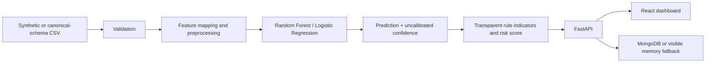

# ThreatLens AI

ThreatLens AI is a defensive network-traffic analytics project for an MCA portfolio. It combines a reproducible ML workflow, transparent rule indicators, a FastAPI service, optional MongoDB persistence, and a responsive React dashboard. It analyzes supplied records and safe synthetic data; it does not capture packets, scan targets, or generate malicious traffic.

## What is implemented

- Deterministic 400-row synthetic CSV generator and safe simulated records.
- Reproducible training/evaluation for Random Forest and Logistic Regression.
- Stratified train/test split, train-fitted missing-value imputation/scaling, class weights, and saved precision/recall/F1/ROC-AUC/confusion-matrix metrics.
- Versioned local model artifacts and API inference with the same ordered feature schema.
- Validated single and bounded batch analysis, CSV schema validation/analysis, alerts, events, dashboard summary, model metrics, and detection settings.
- Explainable rule indicators and a separate 0-100 risk score/severity.
- MongoDB persistence when a database can be pinged; otherwise a clearly reported process-memory fallback.
- React dashboard with API-backed charts, searchable/filterable/paginated alerts, alert details, traffic analysis, CSV upload/report download, model metrics, and settings.

## Architecture



## Requirements

- Windows PowerShell
- Python 3.11+ (tested with Python 3.13.5)
- Node.js and npm
- MongoDB is optional; the application remains usable without it

## Windows setup and run

Run commands from the project root, `D:\ThreatLens AI`.

### 1. Create and activate the Python environment

Use the Python launcher if installed:

```powershell
Set-Location 'D:\ThreatLens AI'
py -3 -m venv .venv
.\.venv\Scripts\Activate.ps1
```

If `py` is not available, use the installed `python` command instead of `py -3`.

### 2. Install backend dependencies

```powershell
python -m pip install --upgrade pip
python -m pip install -r .\backend\requirements.txt
```

### 3. Configure environment variables

```powershell
if (-not (Test-Path .\.env)) {
    Copy-Item .\.env.example .\.env
}
```

The defaults use `mongodb://localhost:27017`. If MongoDB is not running, the API logs the connection failure and serves requests using its process-memory fallback. To use MongoDB Atlas, replace `MONGODB_URI` in `.env` with your own connection string and keep the credentials out of source control. `FRONTEND_ORIGIN` controls the allowed browser origin.

### 4. Generate sample data, train, and review the saved evaluation

```powershell
python -m backend.scripts.generate_demo_dataset
python -m backend.scripts.train_demo_model
python -m backend.scripts.evaluate_model
```

The dataset is generated deterministically at `datasets\sample\network_traffic_sample.csv`. Training writes `demo_model.joblib`, a versioned `demo_model_v1.0.0.joblib`, `model_metadata.json`, and `evaluation_metrics.json` under `backend\artifacts`.

Optional user-supplied data must first be converted to the canonical schema described in [datasets/README.md](./datasets/README.md):

```powershell
python -m backend.scripts.train_demo_model --dataset .\datasets\my-canonical-data.csv
```

Custom CSV results are marked `CUSTOM`; they are not represented as independently verified benchmark results. CIC-IDS2017 and UNSW-NB15 do not share this project's input schema directly and need a documented, reviewed mapping before training.

### 5. Start the backend (Terminal 1)

```powershell
Set-Location 'D:\ThreatLens AI'
.\.venv\Scripts\Activate.ps1
python -m uvicorn backend.app.main:app --host 127.0.0.1 --port 8000 --reload
```

### 6. Install and start the frontend (Terminal 2)

```powershell
Set-Location 'D:\ThreatLens AI\frontend'
npm install
npm run dev -- --host 127.0.0.1 --port 5173
```

Open the dashboard at `http://localhost:5173`.

### One-command development startup

From any PowerShell working directory:

```powershell
& 'D:\ThreatLens AI\start.ps1'
```

It prepares missing dependencies/data/model and starts the API and Vite development server in separate PowerShell windows. Use `-RetrainModel` to regenerate and retrain the synthetic demo:

```powershell
& 'D:\ThreatLens AI\start.ps1' -RetrainModel
```

### 7. Tests and production build

```powershell
Set-Location 'D:\ThreatLens AI'
.\.venv\Scripts\Activate.ps1
python -m pytest backend\tests -q
Set-Location .\frontend
npm run build
```

## URLs and API

- Dashboard: `http://localhost:5173`
- Health: `http://127.0.0.1:8000/api/health`
- OpenAPI Swagger UI: `http://127.0.0.1:8000/docs`
- OpenAPI JSON: `http://127.0.0.1:8000/openapi.json`

Available API routes:

| Method | Route | Purpose |
| --- | --- | --- |
| GET | `/api/health` | Backend, model, and persistence mode |
| GET | `/api/dashboard/summary` | API-backed traffic, threat, severity, and trend counts |
| GET | `/api/alerts` | Search/filter/paginate stored alerts |
| GET | `/api/alerts/{alert_id}` | Alert details |
| POST | `/api/analyze/record` | Analyze one validated record |
| POST | `/api/analyze/batch` | Analyze up to the configured batch size |
| POST | `/api/datasets/validate` | Validate a bounded canonical CSV |
| POST | `/api/datasets/analyze` | Analyze a bounded canonical CSV |
| GET | `/api/models/status` | Loaded model version and feature schema |
| GET | `/api/models/metrics` | Saved held-out evaluation metrics |
| GET | `/api/events` | Recent analysis events |
| GET/PUT | `/api/settings` | Read/update detection thresholds |

## Dataset and ML methodology

The included dataset is synthetic and exists so the project works without network access or external downloads. Its 400 rows contain benign and simulated suspicious examples. The `label` is used only during training and is not a prediction feature. The pipeline uses a fixed canonical feature mapper, validates supported protocols/states, converts infinite/missing numeric values to missing values, and fits imputation/scaling only within each training split. Model selection uses held-out F1; class weights mitigate the generated dataset's class imbalance.

Saved metrics are computed from an actual stratified held-out split and are labeled `DEMO`. The synthetic examples have intentionally separable patterns; their metrics should not be interpreted as benchmark or real-network accuracy. Model confidence is uncalibrated, and risk score is an independent, documented aggregation of rule weights plus model output. The score is not a probability.

For real benchmark work:

1. Obtain CIC-IDS2017 or UNSW-NB15 from the dataset publisher and comply with the publisher's access/license terms.
2. Inspect its feature definitions and labels.
3. Map features to the canonical fields listed in [datasets/README.md](./datasets/README.md); do not assume schemas are interchangeable.
4. Keep label columns as `benign` or `malicious` and do not map unsupported attack labels to confident specific detections.
5. Run the optional `--dataset` training command and inspect its `CUSTOM` report. Do not call it benchmark validation unless the dataset and evaluation protocol genuinely support that claim.

## Threat interpretation

- Prediction: the model's benign/malicious class using the configurable threshold.
- Confidence: model score for the selected class, explicitly uncalibrated.
- Rule indicators: individual feature-based conditions with stable rule IDs and documented contributions.
- Risk score: explainable 0-100 value; severity bands are LOW `<40`, MEDIUM `40-69`, HIGH `70-89`, CRITICAL `90-100`.
- Categories use “like” terminology for activity patterns. A single record cannot prove a port scan or denial-of-service attack; the dashboard explains that limitation.

## Persistence, privacy, and limitations

- MongoDB collections are used for alerts, analysis history summaries, model metadata, and settings when MongoDB is reachable. Indexes support alert filtering/pagination.
- In fallback mode, alerts/settings/events live only in process memory and are lost when the backend restarts. The API health, dashboard, and settings responses show `memory-fallback`; they do not claim durable persistence.
- Uploaded CSV content is read for the request and is not saved as a file or stored in full. Analysis history stores summary fields only.
- No live packet capture, privileged operations, external scanning, or malicious traffic generation is implemented.
- This educational defensive system may produce false positives and false negatives. Real production use requires representative labeled data, calibration, security review, access controls, retention policy, monitoring, and a validated deployment environment.

## Project report outline

See [docs/project_report_outline.md](./docs/project_report_outline.md) for an MCA report structure.

## Troubleshooting

- If the model is missing or needs rebuilding, run the three commands under “Generate sample data, train, and review.”
- If the app shows `memory-fallback`, MongoDB was not reachable when the backend started; check the URI and MongoDB availability, then restart the backend.
- If the dashboard cannot reach the API, keep the backend running and check the health URL and `FRONTEND_ORIGIN` in `.env`.
- CSV uploads must be UTF-8 `.csv` files with the documented canonical columns and configured row/file-size limits.
